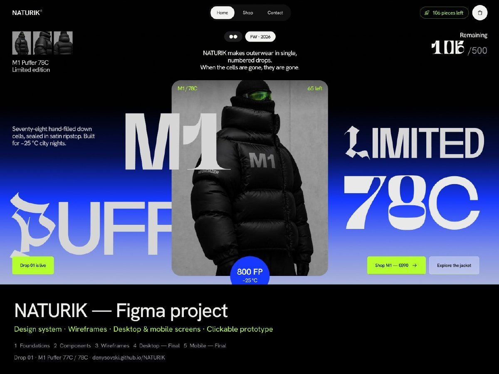
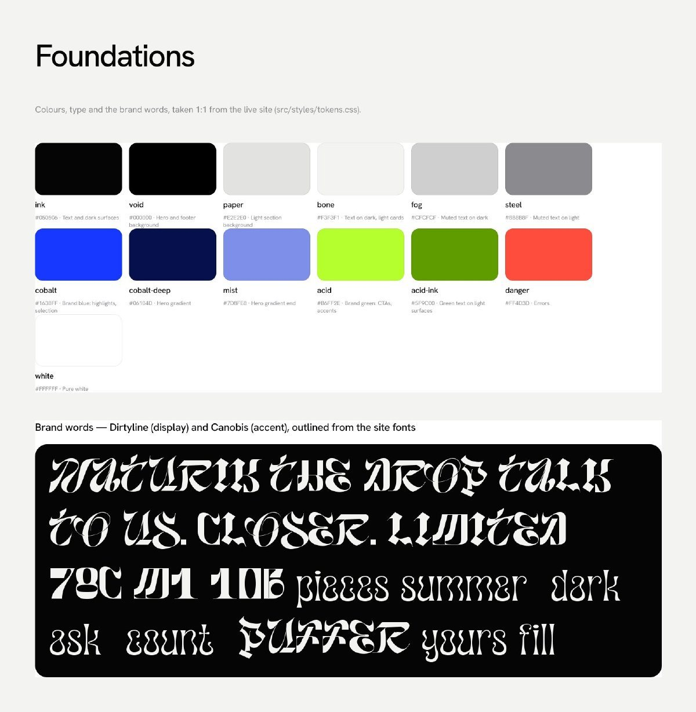
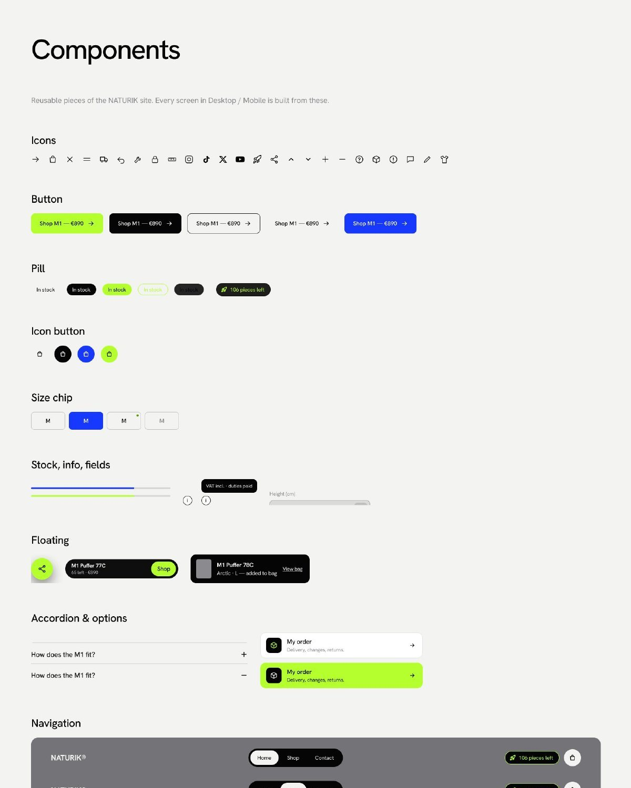
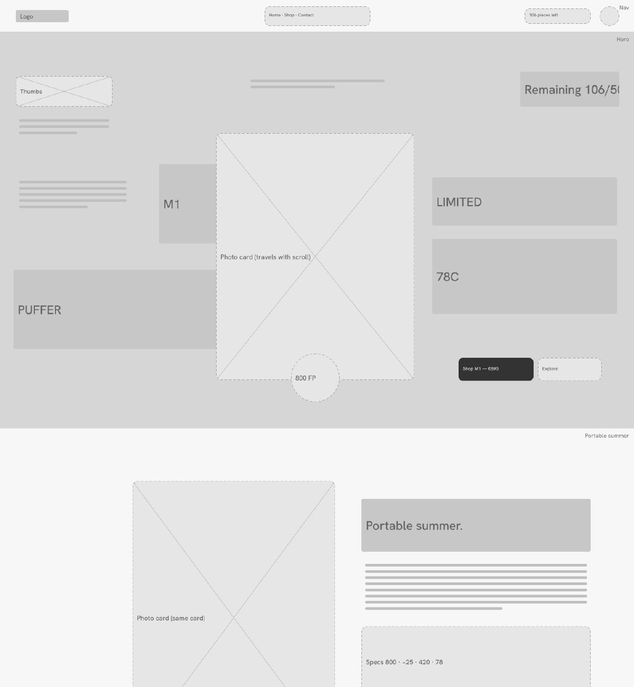
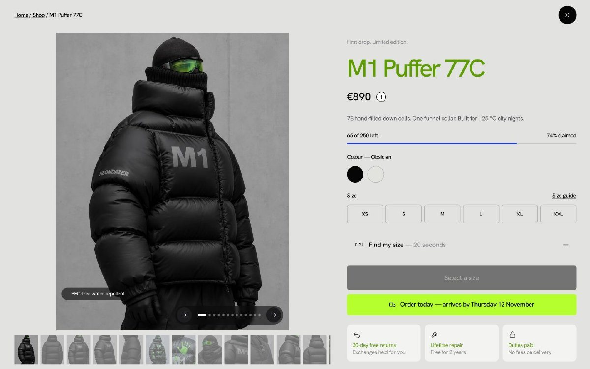
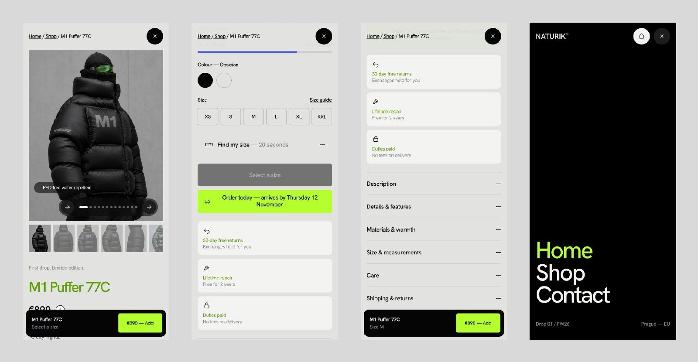

<div align="center">

# NATURIK — Drop 01

**One down jacket. Two colours. 500 numbered pieces. Never restocked.**

A drop store for the M1 Puffer: scroll-driven storytelling, live 3D objects and a complete (simulated) shop with checkout. No framework, no page reloads.

[**Open the live site**](https://denysovski.github.io/NATURIK/) &nbsp;·&nbsp; [Shop](https://denysovski.github.io/NATURIK/shop.html) &nbsp;·&nbsp; [Product](https://denysovski.github.io/NATURIK/shop.html?p=m1-obsidian) &nbsp;·&nbsp; [Contact](https://denysovski.github.io/NATURIK/contact.html)


<br>


</div>

---

## At a glance

| | |
|---|---|
| **The drop** | M1 Puffer **77C** (Obsidian) and **78C** (Arctic), 250 of each. One stock source drives every counter: the nav chip, the hero, Live count, the shop and each product (**106 left: 65 black, 41 white**). |
| **Pages** | Home, Shop with product pages, Contact, Privacy, Terms and 404. Pages switch without reloads, with a tracker/terminal transition. |
| **Shop** | Colour filter, sorting, full-photo gallery with a fact on every photo, a 20-second size finder, a size guide, a waitlist for sold-out sizes and a sliding Obsidian ↔ Arctic switch. |
| **Bag & checkout** | Slide-in bag, free-shipping meter, discount codes, 4-step checkout with card validation (demo only, nothing is charged). |
| **Motion** | Pinned zoom sections, a scroll-scrubbed photo stage, slot-machine counters, a live clock, glitch partners grid and smooth Lenis scrolling. |
| **3D** | A WebGL blob, glossy objects (bike wheel + thermometer, camera, star), a megaphone and a tilted question mark. All three.js, loaded lazily and drawn only while on screen. |
| **SEO** | Meta and Open Graph, JSON-LD (Product, ItemList, FAQ, Organization), sitemap, robots, 404. |
| **Figma** | Design system, wireframes and final desktop and mobile screens with a clickable prototype. See [Figma project](#figma-project) and the [PDF](figma/NATURIK-figma.pdf). |

---

## Home

The homepage tells the story of the jacket from top to bottom. Each section has its own scroll choreography.

| | |
|---|---|
|  **Hero.** The giant M1 Puffer wordmark around one glass photo card, plus *Remaining 106/500* counting up on load. |  **Portable summer.** The photo card travels with the scroll and the specs count up as they enter. |
|  **Our partners.** The section zooms in to fill the screen, then both halves of the grid slide shut over the title. |  **Partners grid.** A 7 × 2 grid of partners, facts and glitching tracker cells joined by dashed lines. |
|  **Partner card.** *Open +* shows a sharp, centred card with a *Since* pill and a link. |  **Live count.** Who is looking right now, stock per size across the whole drop, and the giant *106 left of 500*. |
|  **Signal.** Flashing phrases with tracker boxes. Every phrase links somewhere on the site. |  **Who we are.** A soft WebGL blob next to the manifesto, plus *Follow the studio* links. |
|  **Closer.** A pinned, full-bleed zoom through six details with a crosshair and a clickable index. |  **Who it's for.** One glossy 3D object per type of wearer: a bike wheel with a thermometer, a studio camera and a star. |
|  **Lookbook.** Horizontal scroll through mixed frame sizes and notes. |  **Who showed up.** A real-time clock with a sweeping second hand. Each hour mark shows visitors in that hour, and the numbers roll like a slot machine. |


**Drop 01 — two pieces.** Obsidian left, Arctic right, with pieces left in green and a photo swap on hover.

---

## Shop & product

| | |
|---|---|
|  **The Drop.** *106 pieces left*, one jacket in two colours. |  **Grid.** Colour filter, sorting and two big cards. |
|  **Opening an item.** The card blurs under a spinner until the product page is ready. |  **Product page.** The gallery stays fixed while the right column scrolls. Every photo carries a small fact, shuffled differently per colour. |
|  **Find my size.** Height and chest (digits only, custom steppers) give a recommendation in cobalt. |  **Size guide.** Body and garment measurements, sharp from the first frame. |


**Bag.** Slide-in drawer with a free-shipping meter, quantity steppers and the checkout button.

---

## Contact

| | |
|---|---|
|  **Talk to us.** A big green and blue 3D megaphone, the average reply time and the opening hours. |  **Hours bubble.** Hover the hours for the week, with the weekend *Off* in green. |
|  **What do you need?** A two-step onboarding: pick one of five topics instead of facing one long form. |  **Topic form.** Each topic asks only for what it needs, e.g. height and usual size for sizing help. |


**Before you ask.** The FAQ, with a tilted, glossy 3D question mark.

---

## Mobile

| | | |
|:---:|:---:|:---:|
| <br><sub>Hero</sub> | <br><sub>Live count</sub> | <br><sub>Who it's for, 3D</sub> |
| <br><sub>Who showed up</sub> | <br><sub>Product</sub> | <br><sub>Contact</sub> |

---

## Figma project

The whole store also exists as a Figma file: a small design system, grey-box wireframes and the final desktop and mobile screens, linked into a clickable prototype.

[**Download the PDF export**](figma/NATURIK-figma.pdf) (19 pages) &nbsp;·&nbsp; [Open in Figma](https://www.figma.com/design/QJSaUPJHjrsI6FjJMpKxOJ)



### The idea

Design and code usually drift apart. Here the order was turned around: the site was built first, and the Figma file was then made to match it 1:1, so it can serve as the reference for the next drop. It is meant to be read top to bottom, from the building blocks to the finished screens.

| Page | What is on it |
|---|---|
| **Foundations** | Colour variables (ink, paper, cobalt, acid…), spacing and radius tokens, the brand words in Dirtyline and Canobis, and the product photos. |
| **Components** | Icons, buttons, pills, size chips, stock bar, accordion, contact options, navigation, product card and footer. Each one has variants and properties, e.g. Button: Acid, Dark, Ghost, Light, Cobalt. |
| **Wireframes** | Grey blocks only: section order, hierarchy and what each area does, for desktop (1440) and mobile (390). |
| **Desktop — Final** | Home, Shop, both product pages and Contact, plus the states you can open: Find my size, Size guide, Bag and the sizing form. |
| **Mobile — Final** | Home, Shop, Contact, the product page and the open menu. |

| | |
|---|---|
|  **Foundations.** Colours, tokens and outlined brand words. |  **Components.** Reusable parts with variants. |
|  **Wireframes.** Layout and flow before any visuals. |  **Final screens.** The product page, identical to the site. |
|  **Contact.** The megaphone and question mark are still renders of the real 3D objects. |  **Mobile.** Product, its states and the menu. |

### How it was made

- **Built through the Figma Plugin API.** Variables, components, the wireframes and the prototype links were all created with scripts instead of by hand, so names and tokens stay consistent.
- **Final screens are taken from the live site.** A small script walks the rendered page and writes every visible element as SVG: backgrounds and gradients, borders and radii, shadows and blur, clipping, inline icons and text with its real size, weight and colour. Figma imports that SVG as editable shapes and text layers, not a flat screenshot.
- **Real assets.** Photos are uploaded in full resolution from the site. Headlines set in Dirtyline, Canobis or a metallic gradient are placed as sharp images, because those fonts are not available in Figma. Body text uses Hanken Grotesk as the closest match to Neue Montreal, with letter spacing adjusted so every line keeps its original width.
- **3D as stills.** The WebGL objects (blob, bike wheel, camera, star, megaphone, question mark) are captured as images of the actual render.
- **Pinned sections, one frame each.** Scroll-driven parts such as Closer and the Lookbook are shown as a single state instead of every scroll step.
- **Clickable prototype.** Navigation, product cards, the Obsidian / Arctic switch, Size guide, Find my size, the bag, the contact topics and the mobile menu all link to their screens. Flows start at Desktop — Home and Mobile — Home.
- **PDF.** Exported page by page from the Figma frames into `figma/NATURIK-figma.pdf`.

---

## Try the demo checkout

- Card **4242 4242 4242 4242**, any future date, any CVC
- Codes **DROP01** (−10 %) and **CELL78** (−7.8 %)
- Nothing is charged and no order is sent. The bag lives in your browser.
- *People looking now* and the visitor clock use sample figures. `src/js/components/clock.js` has a `STATS_URL` hook for real analytics.

## Under the hood

- **Vite** multi-page build, with a small plugin for HTML partials and build-time product rendering
- **GSAP + ScrollTrigger** for every scroll animation, and **Lenis** for smooth scrolling
- **three.js**, lazily imported. Each 3D object compiles in idle time and renders only while visible. The blob adapts its resolution to the device.
- A custom SPA router, so pages swap without reloads, with history and focus handling
- Plain HTML, CSS and JavaScript. Fonts: Neue Montreal, Dirtyline and Canobis.

```
index.html · shop.html · contact.html   pages
partials/                               header, footer, overlays (bag, modals, social button)
src/js/core/                            app shell, router, scroll
src/js/components/                      product page, bag, checkout, clock, partners, 3D (blob, who3d, contact3d) …
src/js/data/products.js                 the two colourways, stock and editions
src/styles/                             tokens, components, pages
public/                                 images, fonts, icons, SEO files
figma/                                  Figma export (PDF) and preview images
```

## Run it locally

```bash
npm install
npm run dev       # dev server
npm run build     # production build into dist/
npm run preview   # serve the build
```

Pushing to `main` builds and deploys to GitHub Pages automatically.

---

<div align="center"><sub>Demo store. Product names, partners and figures are for illustration only.</sub></div>
